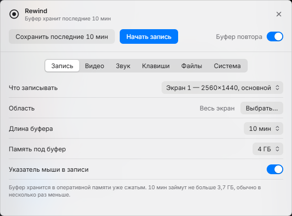

# Rewind

Запись экрана для Windows с буфером повтора: программа всё время держит в памяти последние
минуты и по горячей клавише сохраняет их в файл. Обычная запись «старт — стоп» тоже есть.
Задумана как лёгкая замена ShadowPlay: без оверлея, без учётной записи, почти без нагрузки.

## Что умеет

- **Буфер повтора.** Хранит последние 30 секунд — 60 минут и сохраняет их одним нажатием.
  Буфер лежит в оперативной памяти уже сжатым, диск постоянной записью не изнашивается.
- **Обычная запись** по горячей клавише. Если программа или компьютер аварийно завершатся,
  файл останется читаемым.
- **Что записывать:** любой экран, отдельное окно или выделенная область.
- **Звук двумя дорожками:** звук программ и микрофон отдельно, удобно для монтажа.
- **Звук только из игры:** можно писать звук одной программы (и того, что она запустила), без
  Discord, браузера и уведомлений. Если игра перезапустится, её звук подхватится сам.
- **Понятные имена:** `Видео\Rewind\ELDEN RING‚6-11-12 14-03-05 Клип.mp4` — папка по игре или
  программе, дата и время в начале имени, поэтому по имени файлы идут в порядке создания.
- **История записей** в окне настроек: превью, длительность и размер; открыть, показать в папке,
  переименовать, удалить в корзину.
- **Индикатор записи** в углу экрана с таймером; в саму запись не попадает.
- **Кодеки:** HEVC, H.264, AV1. Сжимает видеокарта, кадр не покидает видеопамять.
- **Можно выключить совсем:** тогда экран не захватывается и нагрузка нулевая.
- Значок в области уведомлений, уведомления, которые не попадают в запись, настройка клавиш.

## Нагрузка

Замеры на Ryzen 7 7700 и RTX 4060 Ti, запись 2560×1440, 60 кадров в секунду, HEVC, две звуковые дорожки:

| Состояние | Процессор | Память |
|---|---|---|
| Всё выключено | 0 % | 46 МБ |
| Буфер включён | около 0,3 % | около 215 МБ и сам буфер |

Сохранение клипа из буфера занимает несколько миллисекунд: видео не перекодируется.

## Установка

Установщика нет. Скачайте `Rewind-…-win64.zip` со страницы
[выпусков](https://github.com/ShuraProgerMain/rewind/releases), распакуйте в любую папку и запустите
`rewind.exe`. Программа сама добавит ярлык в меню «Пуск»; автозапуск вместе с Windows включается
в настройках, вкладка «Система». Там же кнопка «Убрать из системы».

Обновляется сама: раз в сутки проверяет выпуски, скачивает новую версию, сверяет контрольную сумму
и переходит на неё при следующем запуске.

Нужны Windows 11 и видеокарта с аппаратным кодировщиком. Проверено на NVIDIA; AMD запускается,
но качество и битрейт для неё ещё не настроены; Intel пока не поддерживается.

## Клавиши

| Действие | По умолчанию |
|---|---|
| Сохранить последние минуты | Ctrl+Alt+F10 |
| Начать и остановить запись | Ctrl+Alt+F9 |
| Включить и выключить буфер | Ctrl+Alt+F8 |

Меняются в настройках. Запущенной программой можно управлять и из командной строки:
`rewind.exe --send save`, `record`, `buffer`, `quit`.

Записи попадают в `Видео\Rewind`, настройки и журнал — в `%APPDATA%\Rewind`.

## Сборка из исходников

Нужны Rust (MSVC), библиотеки FFmpeg 8.1 для разработки (сборка `lgpl-shared` от
[BtbN](https://github.com/BtbN/FFmpeg-Builds)) и libclang.

1. Распакуйте FFmpeg в `deps\ffmpeg\`.
2. Укажите пути в переменных окружения `FFMPEG_DIR` и `LIBCLANG_PATH` или поправьте `.cargo\config.toml`.
3. `cargo build --release`, затем положите рядом с `rewind.exe` файлы `avcodec`, `avformat`, `avutil`
   и `swresample` из `bin` той же сборки FFmpeg. Скрипт `tools\package.ps1` делает это сам и собирает архив.

Проверки: `tools\ui-test.ps1` (окно настроек), `tools\update-test.ps1` (ярлык, автозапуск, обновление),
`tools\quit-test.ps1` (выход), `tools\sync-test.ps1` (синхронность звука и картинки).

## Лицензии

Rewind — MIT. В состав входят FFmpeg (LGPL 2.1 или новее, неизменённые библиотеки) и шрифт Inter
(SIL OFL 1.1); тексты лицензий лежат в папке `licenses` рядом с программой.

## Качество

Видео сжимается с постоянным качеством, а не с постоянным битрейтом: простые сцены занимают мало,
сложные (трава, дождь, частицы, резкие повороты) получают столько, сколько нужно, до предела
битрейта. Поэтому картинка не рассыпается на квадраты, как при фиксированном битрейте в ShadowPlay
и OBS. Если всё-таки рассыпается — поднимите «Предел битрейта» на вкладке «Видео».

Настройки кодировщика подобраны замерами (`tools\gain-bench.ps1`, `tools\cost-bench.ps1`):
два B-кадра дают то же качество при битрейте на 18–50 % ниже. Пресет p5, двухпроходный режим,
просмотр вперёд и адаптивное квантование выигрыша по PSNR и VMAF не дали и выключены.
